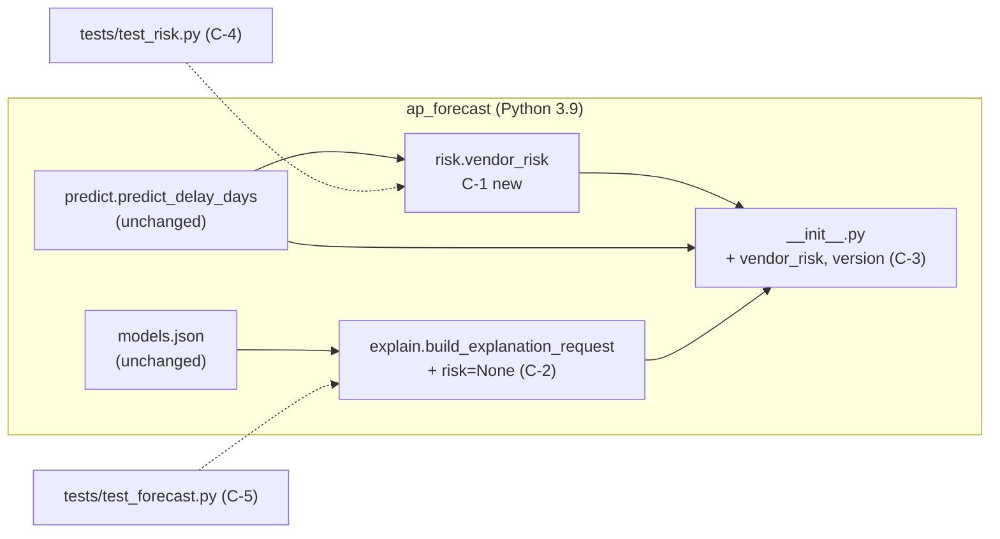

# task.components: FEAT-ZD-48600

Components and layers the Data Science lane creates or updates for FEAT-ZD-48600 ("Show which overdue invoices belong to vendors that usually pay late"). This is DS-04 Identify the components/layers to be changed. The workbook outcome is "the list of components/layers needs to be created/updated with minimum lines of code". This file is a plan for DS-05 (coding) and DS-06 (unit tests). It changes no code.

| Field | Value | Source |
|---|---|---|
| Trace ID | FEAT-ZD-48600 | record:brief |
| Step | DS-04 Identify the components/layers to be changed (attempt 1) | record:brief |
| Owner / gate | Developer / no gate: automated checks, the independent judge and sampled human evaluation | record:brief |
| Inputs | feat.tasks (b0fd4d2), feat.stories (0590ea4), feat.prd (908b58d), feat.trd (3637e51), feat.design (722a98f), task.repo_access (daae080) | record:brief |
| Background read | task.secrets_scope (DS-02), task.db_changes (DS-03), feat.clarifications (DES-03) | journey:task.secrets_scope; journey:task.db_changes; journey:feat.clarifications |
| Lane tasks | TSK-03 (STORY-03, `risk.vendor_risk`) and TSK-04 (STORY-04, `explain.build_explanation_request(..., risk=None)`) | feat.tasks (sections 1, 3) |
| Repository | `ap_forecast`, Python 3.9 standard library, branch `feature/story`, CI `/usr/bin/python3 ci.py` | task.repo_access (section 1); file:ap_forecast/CLAUDE.md |
| Code read | `src/ap_forecast/__init__.py`, `predict.py`, `explain.py`, `models.json`; `tests/test_forecast.py`; `ci.py`; `README.md` | tool:repo; file:ap_forecast/ci.py; file:ap_forecast/README.md |

## 1. Result

**Five files change in one repository: one new source module, two existing source modules, one new test file and one existing test file.** No other layer changes: no data store, no configuration, no CI script, no secret, no other repository.

| # | Component | Layer | Kind | Task | Source |
|---|---|---|---|---|---|
| C-1 | `src/ap_forecast/risk.py` with `HIGH_ABOVE_DAYS`, `MEDIUM_ABOVE_DAYS`, `vendor_risk` | Rule (domain logic, no LLM) | New module | TSK-03 | feat.design (HC-4, B2.1, B2.2, DD-9); feat.tasks (TSK-03) |
| C-2 | `src/ap_forecast/explain.py`: `build_explanation_request` gains `risk=None` as the last parameter | LLM request builder | Changed, additive | TSK-04 | feat.design (HC-5, B2.1, B2.2); feat.trd (C-5, IF-4.1) |
| C-3 | `src/ap_forecast/__init__.py`: import `vendor_risk`, add it to `__all__`, version step from `0.9.0` | Package public API | Changed, additive | TSK-03 (owns the version step) | feat.design (B2.1, DD-11); feat.tasks (section 2, TSK-03) |
| C-4 | `tests/test_risk.py` | Unit tests | New file | TSK-03 | feat.tasks (section 2, TSK-03); feat.design (B2.5) |
| C-5 | `tests/test_forecast.py`: two new tests; existing tests unchanged | Unit tests | Changed, additive | TSK-04 | feat.tasks (section 2, TSK-04); feat.design (B2.5) |



Sources: feat.design (A2 diagram, B2.1) for the new and changed components; tool:repo for the existing imports (`models.json` → `explain`, modules → `__init__`). The test edges are this plan's mapping from feat.tasks (section 2).

## 2. How the existing code works (read before changing it)

| Module | What it does today | What this feature relies on | Source |
|---|---|---|---|
| `predict.py` | `predict_delay_days(history)` returns the rounded mean of the history, with negative values counted as 0, and 0 for an empty history. It reads the iterable once into a list | `vendor_risk` calls it once and compares the integer result. Empty history → 0 → `'low'`; early payments only → `'low'` | tool:repo (`predict.py`); feat.trd (IF-3.3, IF-3.4); journey:feat.clarifications (CL-DS2, CL-DS9) |
| `explain.py` | `load_config()` reads `models.json` next to the module. `build_explanation_request(vendor, predicted_days, config=None)` takes `config or load_config()` and returns `provider`, `model`, `max_tokens` and one user message. It builds the request; it does not send it | The prompt line is the only place `risk` is added; provider, model and `max_tokens` stay on the `cfg` path unchanged | tool:repo (`explain.py`); feat.trd (IF-4.4); journey:task.secrets_scope (section 1) |
| `models.json` | `provider` `acme-llm`, `model` `acme-text-2`, `max_tokens` 300 | Not changed by either task | tool:repo (`models.json`); feat.tasks (TSK-03, TSK-04 "Must not change") |
| `__init__.py` | Re-exports `predict_delay_days` and `build_explanation_request`; `__version__ = "0.9.0"` | `vendor_risk` must be in `__all__` (AC-03.8) | tool:repo (`__init__.py`); feat.stories (AC-03.8) |
| `tests/test_forecast.py` | `test_predict`, `test_request_uses_config`, `test_request_with_explicit_config`; the last passes `config` positionally | These must pass unchanged, which is why `risk` goes last | tool:repo (`tests/test_forecast.py`); feat.stories (AC-04.3) |
| `ci.py` | Compiles `src`, discovers tests under `tests/` with `unittest`, gates coverage of `src/ap_forecast` at 90.0, and flags `print` / `eval` / `exec`, bare `except` and lines over 140 characters in `src/ap_forecast/*.py` A new test file should be named `test*.py` to be discovered (agent judgement on the `unittest` default, as CL-X4 states); every new branch needs a test to keep coverage | file:ap_forecast/ci.py; journey:feat.clarifications (CL-X4, CL-X6) |

**Blast radius.** Inside `ap_forecast`, the only callers of `build_explanation_request` and `predict_delay_days` are the `__init__.py` re-export and `tests/test_forecast.py` (mcp:codegraph). No other lane imports the `ap_forecast` package; the other lanes build against the DC-2 and DC-3 contracts (journey:feat.clarifications CL-X2; feat.design A3). Nothing new calls `build_explanation_request` with `risk`; the end-to-end wiring uses only `vendor_risk` (journey:feat.clarifications CL-DS6; feat.design B5).

## 3. Change per component, with the minimum code

The sketches below are the smallest change that meets the design. They are a plan for DS-05, which writes the final code and comments.

### C-1 `src/ap_forecast/risk.py` (new, TSK-03)

```python
"""Rule-based vendor payment-risk level from the predicted delay. No LLM, no network, no config read."""
from typing import Iterable

from .predict import predict_delay_days

HIGH_ABOVE_DAYS = 30
MEDIUM_ABOVE_DAYS = 10


def vendor_risk(history: Iterable[int]) -> str:
    """'high' if the predicted delay is above HIGH_ABOVE_DAYS, 'medium' if above MEDIUM_ABOVE_DAYS, else 'low'."""
    days = predict_delay_days(history)
    if days > HIGH_ABOVE_DAYS:
        return "high"
    if days > MEDIUM_ABOVE_DAYS:
        return "medium"
    return "low"
```

| Rule | Why | Source |
|---|---|---|
| Call `predict_delay_days` exactly once and keep the result | A generator `history` is consumed on the first pass | journey:feat.clarifications (CL-DS2); feat.tasks (TSK-03) |
| Strict `>` on the rounded prediction; constants 30 and 10 | AC-03.1 to AC-03.4: exactly 30 → `'medium'`, exactly 10 → `'low'` | feat.design (DD-9, B2.2); feat.stories (AC-03.1 to AC-03.4); feat.trd (IF-3.1) |
| Import only `predict_delay_days`, never `explain` | The rule cannot reach the LLM path (AC-03.7) | feat.design (B2.2); journey:feat.clarifications (CL-DS4); feat.stories (AC-03.7) |
| No validation of history values | `predict_delay_days` already applies `int(d)` | journey:feat.clarifications (CL-DS3); feat.design (B2.4) |

### C-2 `src/ap_forecast/explain.py` (changed, TSK-04)

Only the signature line and one conditional statement change; `load_config`, `CONFIG` and the returned dict stay as they are.

```python
def build_explanation_request(vendor: str, predicted_days: int, config=None, risk=None) -> dict:
    cfg = config or load_config()
    prompt = f"Explain in one sentence why vendor {vendor} is predicted to be paid {predicted_days} days late."
    if risk is not None:
        prompt += f" Risk level: {risk}."
    return {...}  # unchanged
```

| Rule | Why | Source |
|---|---|---|
| `risk` is the last parameter, default `None` | Existing positional and keyword calls stay valid (AC-04.3) | feat.trd (IF-4.1); feat.stories (AC-04.3); file:ap_forecast/CLAUDE.md ("Keep existing public signatures") |
| "Given" means `risk is not None`; any non-`None` value is appended without validation | Interim rule pending TQ-4 / CQ-4 | feat.trd (IF-4.2, IF-4.5); journey:feat.clarifications (CL-DS5) |
| Provider, model and `max_tokens` unchanged | AC-04.4 | feat.stories (AC-04.4); feat.trd (IF-4.4) |

### C-3 `src/ap_forecast/__init__.py` (changed, TSK-03)

```python
from .predict import predict_delay_days
from .explain import build_explanation_request
from .risk import vendor_risk

__version__ = "<minor step from 0.9.0, Developer to confirm>"
__all__ = ["predict_delay_days", "build_explanation_request", "vendor_risk"]
```

Existing exports stay. The version step is owned by TSK-03 and shared with TSK-04, so it is made once (feat.tasks section 2, TSK-03 "Done when", assumption TA-3 in section 6; feat.design DD-11). The exact number is not given in any input (open question DSQ-1).

### C-4 `tests/test_risk.py` (new, TSK-03)

| Test | Asserts | Source |
|---|---|---|
| `test_vendor_risk_levels` | Histories predicting 31 → `'high'`, 20 → `'medium'`, 5 → `'low'` | feat.design (B2.5); feat.stories (AC-03.1, AC-03.3) |
| `test_vendor_risk_boundaries` | Single-value histories `[30]` → `'medium'`, `[31]` → `'high'`, `[10]` → `'low'`, `[11]` → `'medium'` | feat.tasks (TSK-03); journey:feat.clarifications (CL-DS1); record:memory (L-007) |
| `test_vendor_risk_empty_and_early` | `[]` → `'low'`; only negative delays → `'low'` | feat.design (B2.5); feat.stories (AC-03.5, AC-03.6) |
| `test_vendor_risk_no_llm` | Patch `ap_forecast.explain.load_config` to fail; `vendor_risk` still returns | feat.tasks (TSK-03); feat.stories (AC-03.7) |
| `test_vendor_risk_exported` | `"vendor_risk" in ap_forecast.__all__` | feat.design (B2.5); feat.stories (AC-03.8) |

Agent judgement on the C-1 sketch: the boundary histories `[31]`, `[30]` and `[10]` reach each of its return statements, so the new module should add no uncovered line. CI measures coverage over the whole package, so a new module without tests would lower it (file:ap_forecast/ci.py; journey:feat.clarifications CL-X6).

### C-5 `tests/test_forecast.py` (changed, TSK-04)

| Test | Asserts | Source |
|---|---|---|
| `test_request_with_risk` | Prompt ends with `' Risk level: high.'` | feat.tasks (TSK-04); feat.stories (AC-04.1) |
| `test_request_without_risk_unchanged` | Result equals today's, with and without explicit `risk=None` | feat.tasks (TSK-04); feat.stories (AC-04.2, AC-04.5) |
| Existing three tests | Pass unchanged | feat.design (B2.5); tool:repo (`tests/test_forecast.py`) |

## 4. Components and layers that do not change

| Component / layer | Status | Source |
|---|---|---|
| `src/ap_forecast/predict.py` | Unchanged | feat.tasks (TSK-03 "Must not change"); feat.design (B2.1) |
| `src/ap_forecast/models.json` (LLM provider configuration) | Unchanged; provider `acme-llm`, model `acme-text-2` | feat.tasks (TSK-03, TSK-04); tool:repo (`models.json`) |
| `ci.py`, `README.md`, `CLAUDE.md` | Unchanged; not in either task's file budget | feat.tasks (TSK-03, TSK-04 "Files in budget"); file:ap_forecast/ci.py; file:ap_forecast/README.md |
| Database / storage | None in this repository and none required | journey:task.db_changes (sections 1, 3); feat.design (A1, DD-1) |
| Secrets | None required or granted for the `ap_forecast` repository; the code builds the LLM request but does not send it. The permission table answers per repository, not per environment; confirming every environment is the open question SSQ-2 | journey:task.secrets_scope (sections 1, 2, 3) |
| Other repositories (`ap_pipeline`, `ap_aging`, `ap_portal`) | Not touched by this lane; no import of another lane's package | journey:feat.clarifications (CL-X2); feat.design (Part C "Lane dependencies") |
| Transport, service, new library | None; standard library only | feat.design (DD-1, DD-3) |

## 5. Order and parallel work inside the lane

TSK-03 and TSK-04 touch different files (C-1, C-3, C-4 versus C-2, C-5), and neither depends on the other in code, so they can be built in either order on the existing `feature/story` branch (feat.tasks section 1; task.repo_access RAQ-1). Commit messages start with the story ID, `STORY-03` or `STORY-04`, and the task ID may follow (feat.tasks section 2). TSK-04's release, not its coding, waits on the order against PROV-ACME-2026-11 (PQ-5) and the Architect's answer to TQ-8 (feat.tasks TSK-04; journey:feat.clarifications CL-DS7, CL-DS8).

## 6. Constraints carried into DS-05 and DS-06

| Constraint | Source |
|---|---|
| Python 3.9 syntax only (no `match`, no `X \| Y` unions); `typing.Iterable` | feat.tasks (section 2); feat.design (NF-9) |
| No `print`, `eval`, `exec` or bare `except`; lines at most 140 characters | file:ap_forecast/ci.py; feat.tasks (section 2) |
| Coverage of at least 90% over `src/ap_forecast` | file:ap_forecast/ci.py; feat.tasks (section 2) |
| Keep existing public signatures; add new functions for new behaviour | file:ap_forecast/CLAUDE.md; feat.design (header "Architecture rule") |
| Synthetic test data only; no secrets or personal data | feat.trd (S-6); journey:feat.clarifications (CL-X9) |

## 7. Note on an input difference

feat.stories TK-03.2 proposes adding the risk tests to `tests/test_forecast.py`, while feat.tasks (section 2; assumption TA-4 in section 6) puts them in a new `tests/test_risk.py`. feat.design B2.5 and feat.clarifications CL-X4 allow either location. This plan follows feat.tasks, the later output, which the journey board shows as approved by the Developer at DES-04. feat.tasks still lists TKQ-2 (confirm the test-file split) as a non-blocking question for the Developer, so the location can move back to `tests/test_forecast.py` without any change to C-1 to C-3 (feat.stories TK-03.2; feat.tasks sections 2, 6, 7; feat.design B2.5; journey:feat.clarifications CL-X4; record:memory).

## 8. Open questions (none blocking)

| ID | Question | Interim answer | Owner (proposed) |
|---|---|---|---|
| DSQ-1 | Which version number replaces `0.9.0`? The design asks for a minor step for the lane to confirm, and no input gives the number | DS-05 proposes the minor step; the Developer confirms it at review | Developer |

Carried, unchanged: TQ-4 and CQ-4 (meaning of "given" for `risk`), TQ-5 (early payments counted as 0), TQ-8 (risk label sent to `acme-llm`), PQ-1 (empty history), PQ-5 (order against PROV-ACME-2026-11), RAQ-1 to RAQ-3 (task.repo_access), SSQ-1 and SSQ-2 (journey:task.secrets_scope). None blocks coding (journey:feat.clarifications section 10).

## 9. Validation check

| Check | Result | Source |
|---|---|---|
| Existing code read and understood | Pass (section 2) | tool:repo; file:ap_forecast/ci.py; mcp:codegraph |
| Every lane task mapped to components | Pass: TSK-03 → C-1, C-3, C-4; TSK-04 → C-2, C-5 | feat.tasks (section 3) |
| Changes stay inside each task's file budget | Pass | feat.tasks (TSK-03, TSK-04) |
| Minimum change: no existing signature, return shape or file outside the budget changed | Pass | feat.design (B2.1, B2.2); file:ap_forecast/CLAUDE.md |
| Secrets | None required for the repository; the per-environment confirmation stays open as SSQ-2 (non-blocking) | journey:task.secrets_scope |
| Database changes | None required | journey:task.db_changes |
| Decision log and lessons (L-007 boundary tests) | Consistent | record:memory |
| Blocking questions | None | — |
